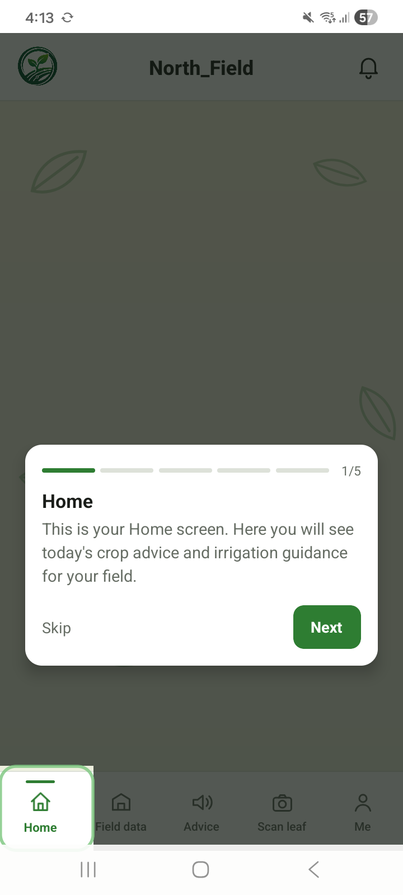
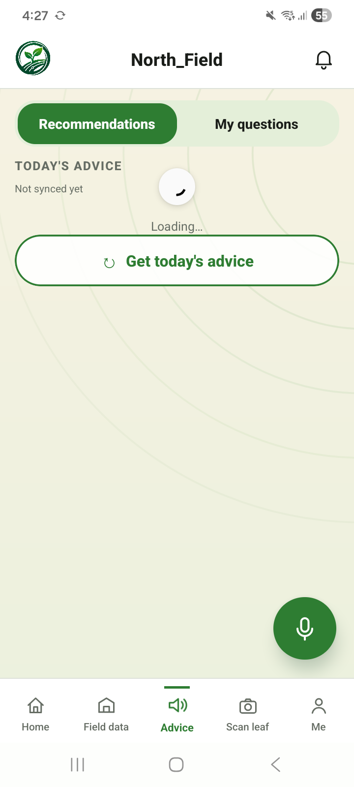
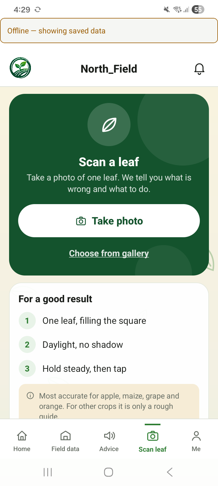
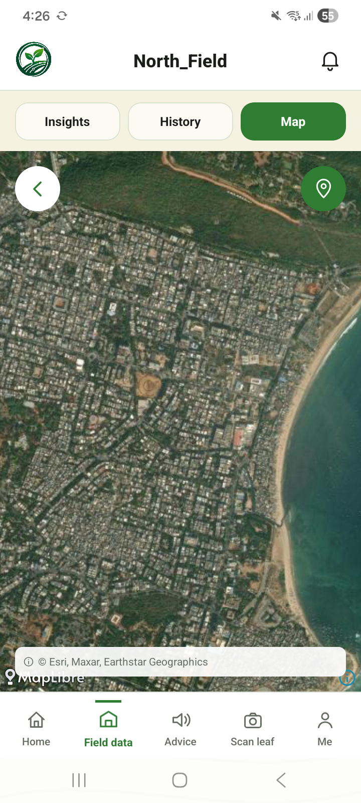
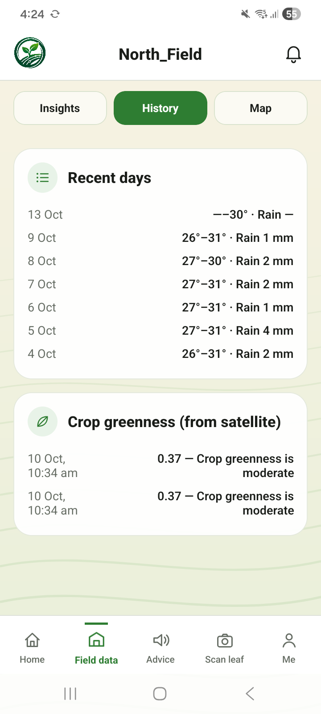
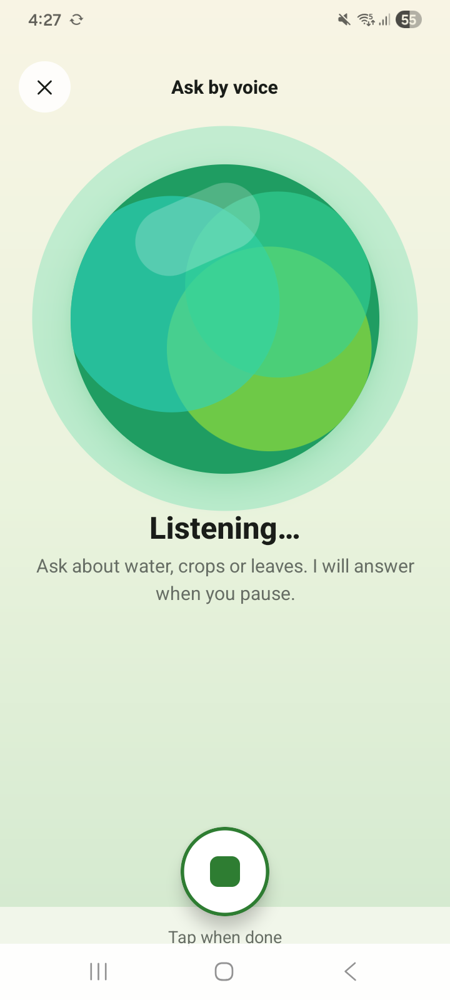
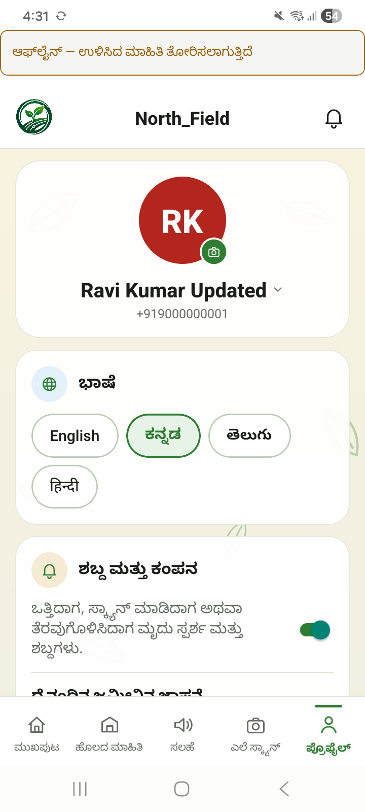
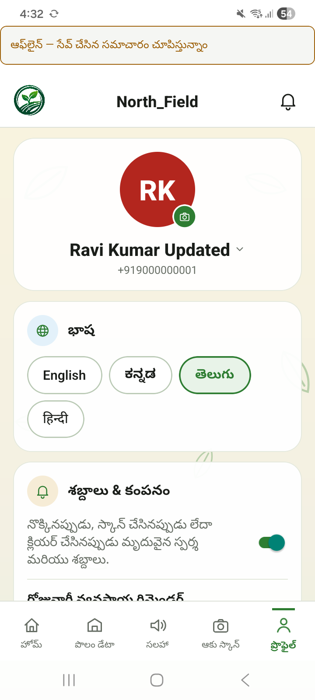
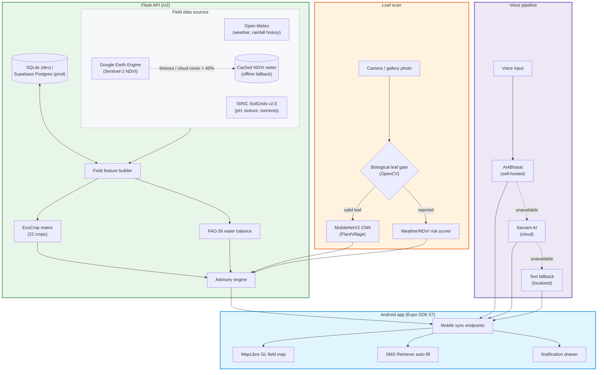

# AGRO MIRAI

**What should I grow, and when do I need to water it?**

That's the whole app, really. A farmer in Bellary points their phone at a field, and AGRO MIRAI pulls real soil, weather, and satellite data for that exact plot, runs it through an FAO-56 water balance and a crop-suitability model, and tells them — in their own language, spoken out loud if they'd rather not read — what to plant and how much to irrigate today. Point a camera at a sick leaf and it'll tell you what's wrong with it too.

<div align="center">

[](https://agromirai.vercel.app/app-release.apk)
[](https://reactnative.dev)
[](https://www.python.org)
[](https://supabase.com)
[](https://earthengine.google.com)
[](LICENSE)

<p>
  <a href="https://agromirai.vercel.app/app-release.apk"></a>
  &nbsp;
  <a href="https://agromirai.vercel.app/download"></a>
  &nbsp;
  <a href="docs/INDEX.md"></a>
  &nbsp;
  <a href="docs/NEXT_TEAM_HANDOVER.md"></a>
</p>

</div>

---

<div align="center">
  
  <p><em>The actual splash screen from the shipping app — not a mockup.</em></p>
</div>

<br/>

### The app, screen by screen (v2.8.18)

<div align="center">
  <table border="0" cellspacing="10" cellpadding="0">
    <tr>
      <td width="25%" align="center">
        <br/>
        <b>Home</b><br/>
        <sub>Weather, soil and field status at a glance</sub>
      </td>
      <td width="25%" align="center">
        <br/>
        <b>Advisory</b><br/>
        <sub>Crop pick and today's irrigation number</sub>
      </td>
      <td width="25%" align="center">
        <br/>
        <b>Scan</b><br/>
        <sub>Photo a leaf, get a diagnosis</sub>
      </td>
      <td width="25%" align="center">
        <br/>
        <b>Field map</b><br/>
        <sub>Draw the field boundary on satellite view</sub>
      </td>
    </tr>
    <tr>
      <td width="25%" align="center">
        <br/>
        <b>Field data</b><br/>
        <sub>Weekly weather and soil history</sub>
      </td>
      <td width="25%" align="center">
        <br/>
        <b>Voice</b><br/>
        <sub>Ask a question out loud, hear the answer back</sub>
      </td>
      <td width="25%" align="center">
        <br/>
        <b>ಕನ್ನಡ</b><br/>
        <sub>Full Kannada UI, not just translated strings</sub>
      </td>
      <td width="25%" align="center">
        <br/>
        <b>తెలుగు</b><br/>
        <sub>Same for Telugu</sub>
      </td>
    </tr>
  </table>
</div>

---

## Why this exists

Three things kept coming up when I looked at what's actually available to a smallholder farmer in India right now:

- **The advice isn't for your field.** Government extension advisories are published district-wide. They don't know your soil's actual pH, what your satellite imagery looked like this week, or what the weather did at your specific coordinates — they're the same bulletin for everyone in a 50km radius.
- **Irrigation is guesswork, and guesswork wastes water.** Most farmers water on a fixed schedule because nobody's handed them a real evapotranspiration number. That overwaters some fields, underwaters others, and depletes groundwater either way.
- **By the time a leaf disease gets noticed by a human, it's often too late** — and most diagnostic tools assume you can read English and fill out a form, which rules out a lot of the people who'd actually benefit most.

AGRO MIRAI tries to close that gap with real data instead of defaults: live soil and weather APIs, actual Sentinel-2 satellite imagery for the field you drew, a physics-based water balance instead of a fixed schedule, and a voice interface so literacy and English fluency aren't a requirement to use it.

---

## How it actually works

**Crop and irrigation advice.** When you add a field, the backend pulls soil texture and pH from ISRIC SoilGrids, rainfall and temperature history from Open-Meteo, and NDVI (a vegetation-health signal) from Sentinel-2 via Google Earth Engine, for that field's exact boundary. That feeds two things: an FAO EcoCrop matrix that ranks which of 22 crops actually suit the season and soil, and a daily FAO-56 soil water balance (Hargreaves-Samani ET₀, adjusted for crop stage and root depth) that says precisely how many millimetres of water the field needs today, not "water it sometime this week."

**Leaf disease scanning.** A photo first goes through a biological gate — an OpenCV check on chlorophyll color ratio and leaf-shaped contours — before anything is classified, so a photo of a person or a piece of paper gets rejected instead of producing a confident wrong answer. Leaves that pass go to a MobileNetV2 CNN trained on the PlantVillage dataset (38 classes), with a weather/NDVI-based rule fallback if the model's unavailable.

**Voice and language.** English, Hindi, Kannada, and Telugu, both directions — speech in, spoken advisory out — through a tiered pipeline (self-hosted AI4Bharat models first, Sarvam AI cloud as backup), degrading to a clearly-labeled text message if both are unreachable rather than failing silently.

**Login.** Name and phone number, no password. Android's SMS Retriever API reads the OTP off an incoming SMS and fills it in automatically — nothing to type, nothing to remember.

Every external call in this stack — weather, soil, satellite, the CNN, voice — has a documented fallback. The rule the whole backend is built around: degrade gracefully, never hand back a 500.

---

## Architecture



---

## Models and algorithms, and why those over something trained

| Layer | Approach | Why not the obvious ML alternative |
|---|---|---|
| Crop recommendation | LLM (Gemini) first, falls back to a deterministic FAO EcoCrop rule engine | A trained classifier needs N/P/K soil values that SoilGrids simply doesn't provide. An earlier RandomForest version recommended watermelon for a cotton field. EcoCrop only needs data this project actually has. |
| Irrigation | Deterministic FAO-56 soil water balance, not a model | A RandomForest urgency classifier measured 72% accuracy — "barely useful." The water balance answers a more precise physical question and shows its work (ET₀, rainfall, days to stress) instead of a label. |
| Leaf disease (live Scan tab) | Vision LLM (OpenRouter, Groq fallback) | Gemini's vision endpoint was unreliable in testing — real timeouts across networks. The CNN below exists and works, but a general vision LLM generalized far better to messy real-field phone photos than a model trained on clean lab-background leaves. |
| Leaf disease (CNN, alternate path) | MobileNetV2, PlantVillage dataset | Kept in the codebase as an offline-capable option; not what the live app calls today. |
| Soil type suggestion | Nearest-match lookup against the 8 soil orders' pH/organic-carbon profile | SoilGrids doesn't output an Indian soil-order label at all — there's no ground truth to classify against, just a closest-match hint. |
| Voice | Sarvam AI cloud primary, AI4Bharat self-hosted fallback | Keeps the main API process light; the heavy self-hosted models run as a separate microservice. |

Full writeups with the actual reasoning and decision history live in [docs/ALGORITHMS.md](docs/ALGORITHMS.md) and [decisions/](decisions/).

---

## Where things stand

- **714 tests passing, 0 failing** (40 skipped — live third-party API calls that need network/credentials not present in CI). See [docs/TEST_CASES.md](docs/TEST_CASES.md) for what's actually covered, and what isn't (mobile UI has no automated test suite yet — that's been manual device testing so far).
- SMS OTP auto-fill lands in under 650ms on real devices.
- CNN inference is ~72ms on-device.
- A GitHub Actions job pings the Render backend every 12 minutes so it doesn't cold-start on a farmer's first request.
- The universal release APK is 53.8MB, covers `arm64-v8a`, `armeabi-v7a`, `x86`, and `x86_64`.

---

## Repository layout

```text
AGRO MIRAI/
├── decisions/                       # 31 architecture decision records — the reasoning behind the bigger calls
├── docs/                            # Documentation, research notes, handoffs, runbooks
│   ├── INDEX.md                     # Start here
│   ├── NEXT_TEAM_HANDOVER.md        # Build, deploy, and ops instructions
│   ├── LOCAL_SETUP.md               # Full local dev setup (backend, mobile, tests)
│   ├── architecture.md              # Full system architecture and data flows
│   ├── ALGORITHMS.md                # What's learned vs. rule-based vs. an LLM call, and why
│   ├── TEST_CASES.md                # What the test suite actually checks
│   ├── SMS_OTP_SETUP.md             # SMS Retriever / Gateway integration
│   ├── screenshots/                 # App screenshots used above
│   └── images/                      # Logo animation and other graphics
│
├── mobile/                          # React Native app (Expo SDK 57)
│   ├── src/screens/                 # HomeTab, AdviceTab, ScanTab, FieldMapScreen, DataTab, MeTab
│   ├── src/components/              # VoiceMode, ChatAssistant, Charts, AnimatedSplashScreen
│   ├── modules/sms-retriever/       # Native Android SMS Retriever module
│   └── android/                     # Native Android project (Gradle, signing config)
│
├── src/agro_mirai/                  # Python 3.12 backend (Flask)
│   ├── acquisition/                 # Open-Meteo, SoilGrids, Earth Engine adapters
│   ├── api/                         # App factory + all /v2 route modules (auth, routes/, voice, vision, LLM clients)
│   ├── auth/                        # OTP providers, session auth
│   ├── models/                      # EcoCrop matrix, FAO-56 water balance, disease risk, leaf gate
│   ├── persistence/                 # DataStore repository (SQLite dev / Supabase prod)
│   ├── processing/                  # Feature building and data normalization
│   └── voice/                       # Tiered voice client and translation
│
├── services/                        # Standalone inference containers
│   ├── cnn-inference/ & cnn-onnx/   # PlantVillage MobileNetV2 serving (ONNX)
│   └── voice/                       # AI4Bharat speech/translation service
│
├── migrations/                      # SQLite + Postgres schema migrations (local dev)
├── supabase/migrations/             # Supabase (production Postgres) migrations
├── specs/
│   ├── core/                        # CI-enforced schema, enum, and OpenAPI contracts
│   └── domains/                     # Domain fixtures
├── tools/                           # CLI utilities (spec checks, fixture seeding)
├── web/
│   ├── landing/                     # Marketing site + APK download portal (Vercel)
│   └── admin/                       # Admin dashboard frontend
├── tests/                           # Backend test suite (api, auth, models, persistence, e2e, ...)
├── render.yaml                      # Render deployment blueprint (backend + services)
└── docker-compose.yml               # Local multi-service container setup
```

---

## Running it locally

Full step-by-step setup — backend, mobile dev client, tests, the works — lives in its own doc rather than cluttering this page: **[docs/LOCAL_SETUP.md](docs/LOCAL_SETUP.md)**.

---

## Author

Built by [Ritesh Bonthalakoti](https://github.com/riteshbonthalakoti) — an experiment in how far real agronomic data and a bit of care about degradation paths could take a farmer-facing app, without pretending to be smarter than it is.

Licensed under [MIT](LICENSE).
